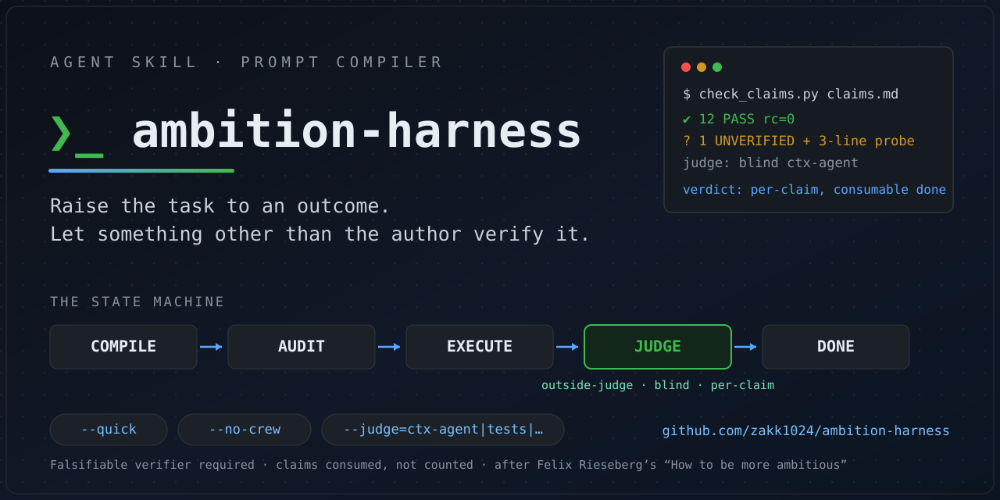
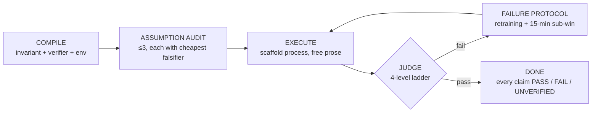

<div align="center">



**A prompt-compiler skill for AI agents.** Tasks in. Verifiable outcomes out.

[](LICENSE)


*English below · 中文說明在下半*

</div>

---

## The problem it solves

Ask an agent to "improve X" and it will confidently declare success. Who checked? Usually: the same model that wrote the answer.

**ambition-harness** compiles your request into three parts *before any work starts*:

| Part | Rule |
|---|---|
| **Invariant** | The goal is an *outcome*, not a task — `fix crashes` becomes `keep apps crash-free` |
| **Verifier** | A **falsifiable command + expected output**. Prose descriptions don't count |
| **Environment manifest** | Telemetry access, version pinning, reproduction environment |

Then it runs a state machine whose core trick is *separating the doer from the judge*.

## The state machine



**The judge ladder** — verification by something other than the author, cheapest layer that suffices:

1. `tests` — a real command the machine runs
2. `ctx-agent` — a fresh-context subagent *blind* reviews the artifact, not the author's narrative
3. `domain` — a subagent with tools checks domain-specific claims
4. `human` — you, at one of two non-optional checkpoints (goal confirmation, final acceptance)

**Done is consumed, not counted**: every claim closes as `PASS`, `FAIL`, or `UNVERIFIED` + a 3-line "looked where, found nothing" record. Silent "trust me" is a contract violation. `scripts/check_claims.py` enforces it mechanically (exit `0` clean · `1` violations · `2` usage/IO).

**Subagents do, not role-play** — crew briefs require tools + data sources + acceptance criteria, plus budget and shared artifacts. *"Don't write like a short seller; do what a short seller does."*

## Install

Works with [Hermes](https://github.com/NousResearch/hermes-agent), Claude Code, or any agent that reads a `SKILL.md`:

```bash
git clone https://github.com/zakk1024/ambition-harness.git \
  ~/.hermes/skills/ambition-harness
```

## Usage

```
/ambition-harness keep the test suite green on all 3 CI platforms
                  verifier: pytest -q && CI matrix PASS

/ambition-harness API p95 < 200ms, verifier: ./bench.sh --judge=tests

/ambition-harness parser survives empty input,
                  verifier: echo "" | parser --strict; echo $? == 0  --quick

/ambition-harness tech-choice memo, every claim source-linked
                  verifier: check_claims.py rc=0  --no-crew
```

| Flag | Effect |
|---|---|
| `--quick` | skip full pipeline — **verifier still mandatory** |
| `--no-crew` | skip the crew stage (no-op, not an error, for non-range tasks) |
| `--judge=ctx-agent\|tests\|domain\|human` | pin the judge layer; `--quick` does not downgrade it |

## What's in the box

```
SKILL.md            54 lines — trigger rules, fast path, state map. The rest lazy-loads.
chapters/   (6)     goal-compiler · judge-ladder · execution-voice · range-crew ·
                    evidence-cases · failure-modes
references/ (13)    claim-format · judge-tools · prompt-compiler · assumption-audit ·
                    decision-checkpoints · subagent-templates · exemplars · …
scripts/check_claims.py    claim-ledger verifier
tests/                     fixture-pass / fixture-fail (rc 0/1 contract)
```

Design rules baked in: thin core (context is expensive), per-node lazy loading, provenance discipline (every quote carries original + translation + source, traced in `references/sources.md`).

## Honest notes

- The claim **"commitments collapse under time pressure"** is a *hypothesis pending agent experiments* — the skill says so itself.
- The `--judge` ↔ level mapping gap for custom judges is a known low-priority issue.
- Derived from Felix Rieseberg's essay [*How to be more ambitious*](https://felixrieseberg.com/how-to-be-more-ambitious-a-tutorial-for-humans-with-models/) — quotes used with attribution; the full source ledger ships in `references/sources.md`.

## License

[MIT](LICENSE) © zakk1024

---

<div align="center">

## 中文速覽

**ambition-harness** 把「幫我把 X 弄好」編譯成三件組：**不變量**（outcome 而非 task）、**可否證驗證器**（命令＋預期輸出，描述文字不算）、**環境清單**——然後走狀態機，核心招式是**做事者與評判者分離**：judge 階梯四層（tests → 盲審 ctx-agent → domain → human），最低可用層優先。done 採**消耗制**：每條宣稱結帳為 PASS／FAIL／UNVERIFIED＋三行查無記錄，靜默「相信我」即違規。subagent **做事而非演戲**（工具＋資料＋驗收三必填）。旗標三枚：`--quick`（免全程，驗證器仍強制）、`--no-crew`、`--judge=`。薄核心 54 行，其餘按節點載入。源自 Felix Rieseberg 之〈How to be more ambitious〉，引言皆附原文＋出處。

</div>
